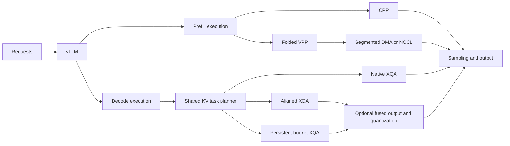

# Architecture

Qwen Infra extends vLLM at three levels: pipeline scheduling for prefill,
attention work assignment for decode, and CUDA fusion at producer/consumer
boundaries. vLLM provides model loading, continuous batching, sampling and the
OpenAI-compatible server.



## Prefill: folded VPP

Four physical ranks each execute two eight-layer virtual stages of the
64-layer dense backbone:

| Rank | Forward traversal | Return traversal |
| --- | --- | --- |
| 0 | Layers 0–7 | Layers 56–63 |
| 1 | Layers 8–15 | Layers 48–55 |
| 2 | Layers 16–23 | Layers 40–47 |
| 3 | Layers 24–31 | Layers 32–39 |

Each rank serializes its two stages on a main compute stream. Rank 3 folds
locally from the first traversal into the return traversal; six inter-rank
edges carry BF16 hidden states and residuals. The in-flight window is seven
batches, with warmup depths 7/5/3/1 and interleaved forward/return work. FIFO
ordering preserves each layer's recurrent-state frontier. Rank 0 samples after
the final stage.

The default segmented-DMA transport pipelines device → registered host ring →
device copies. Each rank shares two source slots, three receive slots, one D2H
stream and one H2D stream. CUDA events connect production, transfer and
consumption; a C++ progress thread advances segments through copy engines.
Cross-direction prefetch prepares both forward and return inputs. NCCL is
available as an alternative boundary transport.

See [VPP communication](vpp-resources.md) for buffer ownership, events, credits
and the memory budget. The runnable prefill profile uses TP1/PP4 and produces
one output token per request.

### Context growth and pipeline bubbles

For a chunk of C new tokens with H tokens of history, the causal full-attention
work is proportional to:

```text
C*H + C*(C+1)/2
```

A simple equal-stage CPP model adds linear layers and fixed overhead:

```text
t(j) = a*C + b*(C*H(j) + C*(C+1)/2) + c
F(s,j) = max(F(s,j-1), F(s-1,j)) + t(j)
```

At fixed C, successive chunks increase history by C, so their compute-cost
increment is approximately `b*C*C`. The idealized pipeline completion time is
`sum(t(j)) + (P-1)*t(last)`: the adjacent-chunk increment stays approximately
constant while the accumulated fill/drain term grows with context. Its share
of total work can shrink even as its absolute duration increases.

VPP changes stage placement and execution order to improve overlap across this
uneven progression. The model separates quadratic full-attention work from
linear GDN work; measured traces additionally capture communication, host
submission and heterogeneous layer costs. [Results](results.md#pipeline-cost-model)
show the modeled bubble durations at several context lengths.

## Decode: bucket attention

Requests in a decode batch can have very different KV lengths. Equal request
counts per CTA then produce unequal work: CTAs assigned short sequences finish
while those assigned long sequences continue on the critical path.

The bucket path divides requests into KV-tile work and assigns bounded task
intervals across CTAs. Persistent CTAs can consume work from several requests.
An aligned path keeps request ownership compact for more balanced workloads;
automatic routing selects native, aligned or persistent execution.

A forward step prepares a shared task map for attention layers with compatible
request order and length metadata. Each layer binds its own Q, KV and output
tensors. Stable plan and scratch buffers support CUDA Graph replay. The XQA
task body handles NVFP4 cache loading and attention, and the combine stage
merges normalized partial outputs using FP32 row maxima and sums.

The deployment geometry and graph settings are listed in
[supported configurations](installation.md#supported-configurations).

## Kernel fusion

| Fusion | Producer operations | Output consumed by |
| --- | --- | --- |
| MLP input | BF16 residual add, Gemma RMSNorm, NVFP4 quantization and packing | Native NVFP4 MLP GEMM; updated residual retained in BF16 |
| Attention input | QK normalization, RoPE, gate layout and NVFP4 KV append | Bucket attention |
| Attention output | Attention output, sigmoid gate/product and static FP8 quantization | Native output projection |

`decode-fused` installs all three around the bucket execution path. Native
projections, tensor-parallel reductions and the LM head retain their existing
implementations. Fusion directly produces consumer layouts, eliminating
intermediate tensors and separate launches.

## Precision

| Tensor / operation | Format |
| --- | --- |
| Quantized model weights | Mixed NVFP4 and FP8, following the checkpoint's module configuration |
| Hidden states and residuals | BF16 |
| KV cache storage | Packed NVFP4 with native scales |
| Attention QK / PV | BF16 |
| Attention softmax / accumulation | FP32 |
| GDN recurrent state | FP32 |
| Fused MLP input / output-projection input | Packed NVFP4 / FP8 |

[Integration design](design.md) maps these execution paths to source files and
vLLM extension points.
