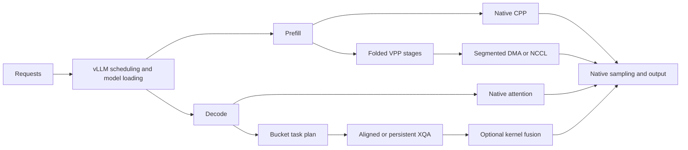

# Architecture

The package adds focused execution paths to vLLM. vLLM continues to own model
loading, continuous batching, request handling, sampling and the HTTP server.
Prefill and decode can be optimized independently; this release does not add a
new disaggregated-serving controller.



## Prefill: folded VPP

For the supported 64-layer dense backbone, four physical ranks each own two
eight-layer stages. The logical execution is:

| Logical rank | First traversal | Return traversal |
| --- | --- | --- |
| 0 | Layers 0–7 | Layers 56–63 |
| 1 | Layers 8–15 | Layers 48–55 |
| 2 | Layers 16–23 | Layers 40–47 |
| 3 | Layers 24–31 | Layers 32–39 |

The two center stages are local to rank 3. Six inter-rank edges carry
`hidden_states` and `residual`, both BF16. A bounded rank-local continuation queue
preserves recurrent-state order while overlapping different chunks. Sampling
occurs after the return traversal on rank 0.

The segmented-DMA transport uses preallocated device slots, registered shared
host memory, CUDA copy streams and completion events. Its C++ progress thread
advances bounded D2H/H2D segments. Source slots remain owned until the relevant
completion; host storage is not reused before the destination transfer finishes.
It uses CUDA copy engines rather than launching a bespoke GPU data-copy CTA.
NCCL is an alternative transport; its internal transport selection remains NCCL's
responsibility. The library does not assume that GPU P2P is enabled or disabled.

The rank-shared resource design separates a rank's physical payload storage from
each edge's logical seven-entry sequence window. Two source slots serve both
traversals, three receive slots hold the current consumer and bounded lookahead,
and one stream per copy direction is shared. Source credit returns after D2H;
receive credit returns after the compute stream's final consumer event. The
original batch, sequence, generation and READY/ACK identities remain per edge.
See [the resource design and focused validation plan](vpp-resources.md).

The implemented VPP adapter is P+1, with TP1/PP4 and two traversals. Prefix
caching, asynchronous scheduling, LoRA and speculative decoding are not supported
by this adapter. Native mode has its own vLLM support surface.

For a fixed chunk of C new tokens and history H, the full-attention work scales
with `C*H + C*(C+1)/2`. A simple equal-stage model is

```text
t(j) = a*C + b*(C*H(j) + C*(C+1)/2) + c
F(s,j) = max(F(s,j-1), F(s-1,j)) + t(j)
```

With fixed C and successively growing history, adjacent chunk costs differ by
approximately `b*C*C`. The idealized pipeline completion time is
`sum(t(j)) + (P-1)*t(last)`. Adjacent dependency gaps can be approximately fixed
while the cumulative fill/drain term grows with context. The total attention
work is quadratic; GDN work is not. Real communication, heterogeneous stages and
mixed requests require a measured dependency graph, not this formula alone.

## Decode: bucket attention

Paged KV requests can have very different visible lengths. Assigning comparable
numbers of requests to CTAs does not ensure comparable work. The bucket planner
partitions KV-tile work into bounded intervals; a persistent CTA may process
tasks from several requests. Aligned ownership reduces unnecessary fanout for
more balanced cases. Native routing remains available when its lower overhead
is preferable or the extension's tensor contract does not apply.

Planning is shared across attention layers with compatible request ordering and
length metadata. Each layer retains its own Q/KV/output pointers. Stable buffers
are refreshed at the per-forward boundary and reused under CUDA Graph replay.
Partial attention state is merged with the native normalized-output and FP32
max/sum semantics. Scheduling changes do not imply FP4 attention matrix products.

The current deployment adapter supports BF16 Q/O, D256, six local Q heads and
one local KV head, q1, page32 NVFP4 cache, and bounded rows. These are properties
of this implemented kernel, not universal requirements of attention bucketing.
The newer multi-shape upstream contribution is separate from this automatic
dispatch/fusion path and its measurements.

## Kernel fusion and precision

The three optional transformations are:

1. BF16 residual addition and Gemma RMSNorm directly produce packed NVFP4 MLP
   input plus native scales, retaining the updated BF16 residual.
2. QK normalization, RoPE/gate layout and NVFP4 KV append share a producer.
3. Final attention output, BF16 sigmoid/product and static FP8 quantization
   produce the existing output-projection input format.

Weights use the model's mixed quantization: NVFP4 modules coexist with FP8
projections. Hidden/residual tensors stay BF16; attention QK/PV uses BF16 with
FP32 softmax/accumulation. GDN recurrent state remains FP32. Native projections,
tensor-parallel reductions and the LM head retain their original implementations.

Fusion is opt-in and retains native fallbacks. Stable named graph owners and
normal compiler cache fingerprints prevent stale process-local object identities
from being reused by cached graphs. This does not require an exact source hash
or a bitwise output-equivalence gate.

## Portability

Model locations, devices, caches and output locations are inputs. Build discovery
uses the active environment and installed CUDA/NCCL/FlashInfer headers. A normal
dependency lock and build-cache digest support repeatable installation; neither
requires a private machine or historical benchmark directory. See
[the release design](design.md) for the extraction boundary.
