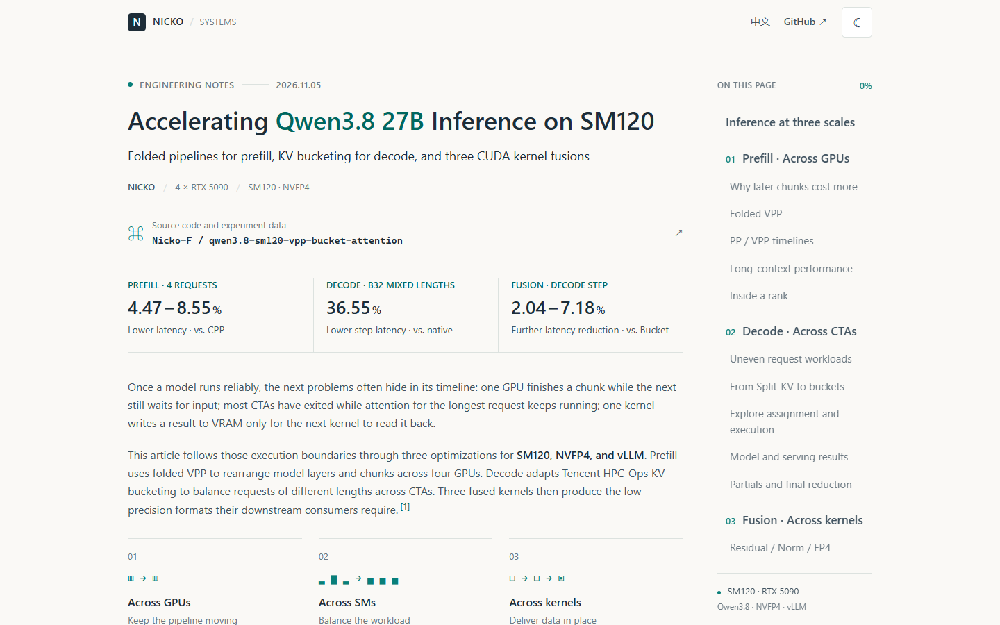

# Accelerating Qwen3.8 27B Inference on SM120

Folded pipelines for prefill, KV bucketing for decode, and three CUDA kernel fusions.

**[Read the article](https://nicko-f.github.io/qwen3.8-sm120-vpp-bucket-attention/) · [中文版](https://nicko-f.github.io/qwen3.8-sm120-vpp-bucket-attention/zh-CN.html)**

