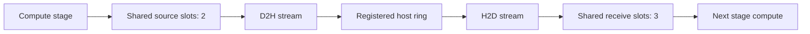

# VPP communication

The segmented-DMA transport overlaps stage computation with device-to-host and
host-to-device copies. Forward and return traversals share a rank-level device
buffer pool and copy streams, while each wire edge maintains its own ordering
and control state.

## Streams and dataflow

Each rank uses one main compute stream, one D2H send stream, one H2D receive
stream and a C++ progress thread. The eight virtual stages retain the seven-batch
in-flight window, 7/5/3/1 warmup and interleaved forward/return order described
in [architecture](architecture.md#prefill-folded-vpp).



A producer writes BF16 hidden states and residuals directly into a source slot.
CUDA plane-ready events let D2H start as each output becomes available. Data
passes through an eight-segment host ring, with 16 MiB per segment. READY/ACK
publications connect source progress to destination H2D. CUDA copy engines
perform the transfers; the progress thread advances descriptors and events.

The host ring is per edge. Segmentation pipelines large boundaries through
bounded storage: a C8192 hidden/residual pair is 160 MiB, while the ring holds
128 MiB and recycles segments after destination completion.

## Shared device slots

The rank-level pool contains two source slots and three receive slots, allocated
at transport initialization. Both traversals borrow fixed-address views from
these arenas. The compute stream serializes local stages, allowing the current
output to transfer while the next output uses the other source slot.

Three receive slots hold the active input and up to two prefetched inputs.
Prefetch considers both incoming directions and local stage priority, with one
unconsumed speculative input per incoming edge. This lookahead keeps return
traffic progressing alongside forward traffic.

The logical W=7 admission window tracks in-flight work. Physical slot capacity
tracks the outputs being sent and inputs being consumed at one rank; these
resources have separate lifetimes.

| Resource | Acquire | Release |
| --- | --- | --- |
| Source slot | Before producing a boundary output | After its D2H completes |
| Host-ring segment | Before D2H writes the segment | After destination H2D completion and ACK |
| Receive slot | After a matching input descriptor is ready | After the stage's final consumer event |

Credits bound outstanding use. Slot generations distinguish reuse, while batch,
sequence, READY/ACK and wire identities stay edge-local. The compute stream
waits on the matching receive event; the send stream waits on the producer's
plane-ready event.

### Cross-direction prefetch

The control path admits FIFO headers for each edge. The progress thread checks
the next segment's READY publication and stable 96-byte descriptor under its
existing mutex, then reserves a receive slot for a matching admitted input.
Peeking leaves sequence and ACK state intact. When the stage consumes the
input, it completes the original Gloo header receive and cross-checks its
identity before exposing the tensors.

## Memory budget

For chunk capacity C and hidden width 5120, a BF16 hidden/residual slot occupies:

```text
slot_bytes = C × 5120 × 2 tensors × 2 bytes
rank_payload = (2 source + 3 receive) × slot_bytes
```

| Capacity | Slot size | Shared payload/rank | Edge-owned middle-rank payload | Saved/middle rank |
| --- | ---: | ---: | ---: | ---: |
| C2048 | 40 MiB | 200 MiB | 1120 MiB | 0.898438 GiB |
| C8192 | 160 MiB | 800 MiB | 4480 MiB | 3.593750 GiB |

At C8192, the middle-rank communication payload falls by 82.1%. Outer ranks save
1.40625 GiB each, giving 10 GiB across four GPUs. Payload capacity stays constant
as context length grows; longer inputs traverse the same buffers more times.
Model weights, KV cache, graph scratch and host-ring storage are budgeted
separately. vLLM can use released GPU headroom for KV cache when its memory
budget is automatic.

`--resource-layout rank` is the default DMA layout. The `edge` layout provides
an independently owned pool at each endpoint for comparisons.

## Transport tests

The C8192 test sends 20 messages over each of six edges, covering 120 boundary
receives. Valid row counts are 0, 1, 17, 4096 and 8192. It exercises delayed plane
publication, logical-slot wraparound, retired-ticket rejection and final drain.

| Rank | Device payload | Peak source slots | Peak receive slots | Forward / return prefetched and consumed |
| --- | ---: | ---: | ---: | ---: |
| 0 | 800 MiB | 2 | 2 | 0 / 2 |
| 1 | 800 MiB | 1 | 3 | 18 / 12 |
| 2 | 800 MiB | 2 | 3 | 14 / 18 |
| 3 | 800 MiB | 1 | 2 | 9 / 0 |

Speculative occupancy reaches two on middle ranks; all slots and queues drain
to zero live ownership. The test uses library revision `8161a2d` and test
revision `8e68e9b`.

## Model measurements

Each point processes four P+1 requests, with one warm bank and three timed
banks. Both layouts use the same NUMA-local GPUs, default native tactics,
6 GiB KV per rank and a maximum of eight sequences. Timings cover the complete
bank after loading and compilation.

| Capacity | Input/request | Edge median, s | Shared median, s | Edge range, s | Shared range, s |
| --- | ---: | ---: | ---: | ---: | ---: |
| C2048 | 8192 | 1.450957 | 0.883493 | 1.447842–1.458284 | 0.881769–1.442930 |
| C8192 | 32768 | 7.028552 | 4.564127 | 7.018437–7.032519 | 4.557483–7.006229 |
| C8192 | 65536 | 11.476845 | 11.490873 | 11.433025–11.496515 | 11.454258–11.508391 |
| C8192 | 131072 | 34.455116 | 34.466631 | 34.452177–34.469092 | 34.461896–34.478624 |

Short-bank shared timings include a slow sample near the edge-owned timing.
At 64K and 128K the ranges overlap, with effectively unchanged latency and the
same fixed memory savings. All individual samples are in
[vpp_resources.csv](../benchmarks/vpp_resources.csv).

| Capacity / input | Middle-rank peak allocated, edge | Middle-rank peak allocated, shared |
| --- | ---: | ---: |
| C2048 / 8K | 15.869829 GiB | 14.971391 GiB |
| C8192 / 32K | 22.167905 GiB | 18.574155 GiB |
| C8192 / 64K | 22.167967 GiB | 18.574217 GiB |
| C8192 / 128K | 22.168091 GiB | 18.574341 GiB |

Peak allocated memory is `torch.cuda.max_memory_allocated` over model loading,
profiling and execution. KV allocation remains fixed at 502 native cache blocks
with a 2784-token full-attention block size. At 64K and 128K, native hybrid-cache
capacity is 1,218,502 and 1,290,169 tokens respectively.

### Occupancy and backpressure

Model execution reaches the configured two-source/three-receive occupancy.
Credit waiting bounds host enqueueing while the GPU produces and transfers
outputs. These counters accumulate across ranks and setup/warm/timed phases:

| Input/request | Shared source waits | Source wait sum, ms | Shared receive waits | Receive wait sum, ms |
| --- | ---: | ---: | ---: | ---: |
| 32768 | 73 | 4789.294 | 3 | 62.374 |
| 65536 | 281 | 18913.872 | 0 | 0 |
| 131072 | 493 | 64011.216 | 2 | 298.295 |

Waits overlap with compute and with waits on other ranks, so they describe
host backpressure separately from the bank times above. All six edges publish
outputs directly: 68 publications per edge at 8K/32K, 132 at 64K and 260 at
128K. Each run completes its requests and drains transport ownership.

[Benchmarking](../benchmarks/README.md#vpp-transport-and-resource-comparison) contains the
transport and model commands.
